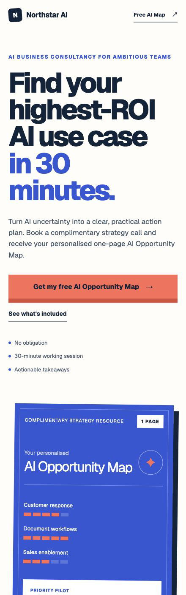

<div align="center">

# Northstar AI

**A mobile-first lead-generation website for an AI business consultancy.**

[](https://github.com/alfredang/northstar-ai/actions/workflows/deploy-pages.yml)


[Live Demo](https://alfredang.github.io/northstar-ai/) ·
[Report a Bug](https://github.com/alfredang/northstar-ai/issues) ·
[Request a Feature](https://github.com/alfredang/northstar-ai/discussions)

</div>

## Screenshot



## About

Northstar AI is a one-page consultancy landing page built to convert business
visitors into qualified enquiries. The lead magnet offers a complimentary
30-minute AI strategy call and a personalised AI Opportunity Map.

The project is deliberately lightweight: it uses plain HTML, CSS, and browser
JavaScript with no Node.js, npm, framework, database, or build step.

## Features

- Conversion-focused hero and lead-magnet offer
- AI Opportunity Map preview
- Consultancy outcomes and testimonial sections
- Mobile-first responsive layout
- FormJS validation loaded directly in the browser
- Email-based enquiry handoff for static hosting
- Accessible form labels, focus states, and reduced-motion support
- Open Graph and X social-sharing metadata
- Automated GitHub Pages deployment

## Tech stack

| Layer | Technology |
| --- | --- |
| Structure | Semantic HTML5 |
| Styling | Responsive CSS3 |
| Interaction | Vanilla browser JavaScript |
| Form validation | FormJS via jsDelivr |
| Hosting | GitHub Pages and OpenAI Sites |
| Automation | GitHub Actions |

## Architecture

```text
Browser
├── index.html        Page structure and content
├── styles.css        Responsive visual system
├── script.js         FormJS validation and enquiry flow
└── og.png            Social-sharing artwork
         │
         └── mailto:  Prepared enquiry opens in the visitor's email client
```

There is no application server or persistent database. Replace the placeholder
recipient in `index.html` before using the enquiry form publicly.

## Project structure

```text
northstar-ai/
├── .agents/
│   └── commands/
│       └── github-push-secure.md
├── .github/
│   └── workflows/
│       └── deploy-pages.yml
├── .openai/
│   └── hosting.json
├── index.html
├── styles.css
├── script.js
├── og.png
├── screenshot.png
├── worker.js          OpenAI Sites static-file adapter
└── README.md
```

## Getting started

No installation is required.

```bash
git clone https://github.com/alfredang/northstar-ai.git
cd northstar-ai
open index.html
```

You can also serve the folder with any basic static-file server.

## Configure the enquiry recipient

In `index.html`, replace:

```html
data-recipient="hello@northstar-ai.example"
```

with the real business email address. The form validates the enquiry using
FormJS and opens a prepared email for the visitor to review and send.

## Deployment

Every push to `main` triggers
[the GitHub Pages workflow](.github/workflows/deploy-pages.yml). It prepares a
minimal artifact containing only the public website files and deploys it without
Node.js.

- GitHub Pages: <https://alfredang.github.io/northstar-ai/>
- OpenAI Sites: <https://northstar-ai-consultancy.sales531787.chatgpt.site/>

## Security

The project command
[`/github-push-secure`](.agents/commands/github-push-secure.md) requires a
blocking secret scan before staging or pushing. Sensitive environment files,
private keys, credentials, archives, and third-party reference material are
excluded through `.gitignore`.

## Contributing

1. Fork the repository.
2. Create a focused branch.
3. Test the static site locally.
4. Open a pull request with a clear summary.

Use [GitHub Discussions](https://github.com/alfredang/northstar-ai/discussions)
for ideas and general questions.

## Developed by

[Tertiary Infotech Academy Pte Ltd](https://www.tertiaryinfotech.com/)

If this project is useful, consider starring the repository.
